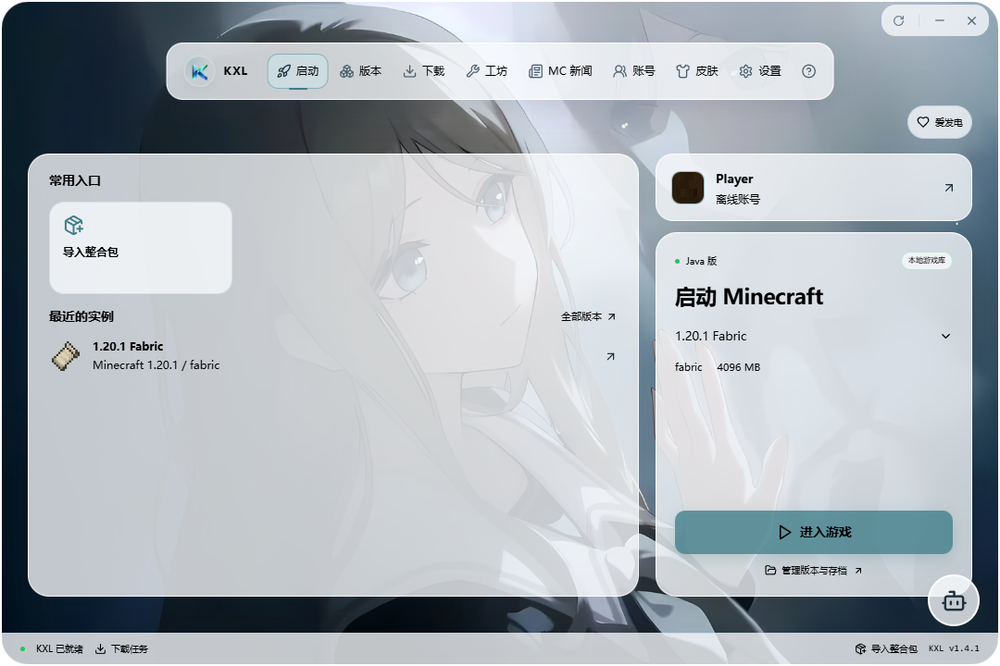
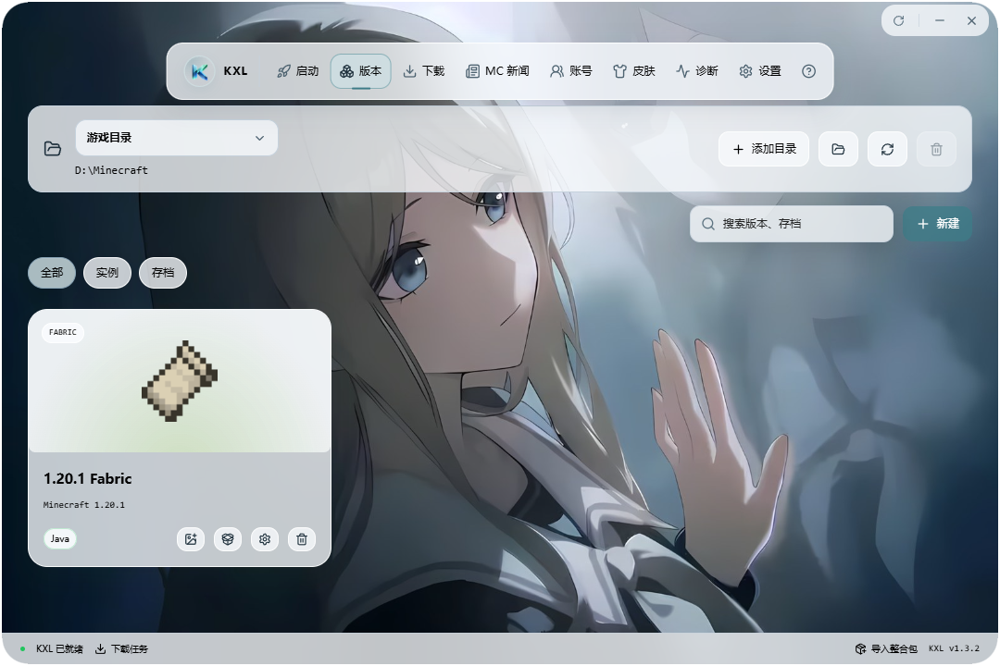
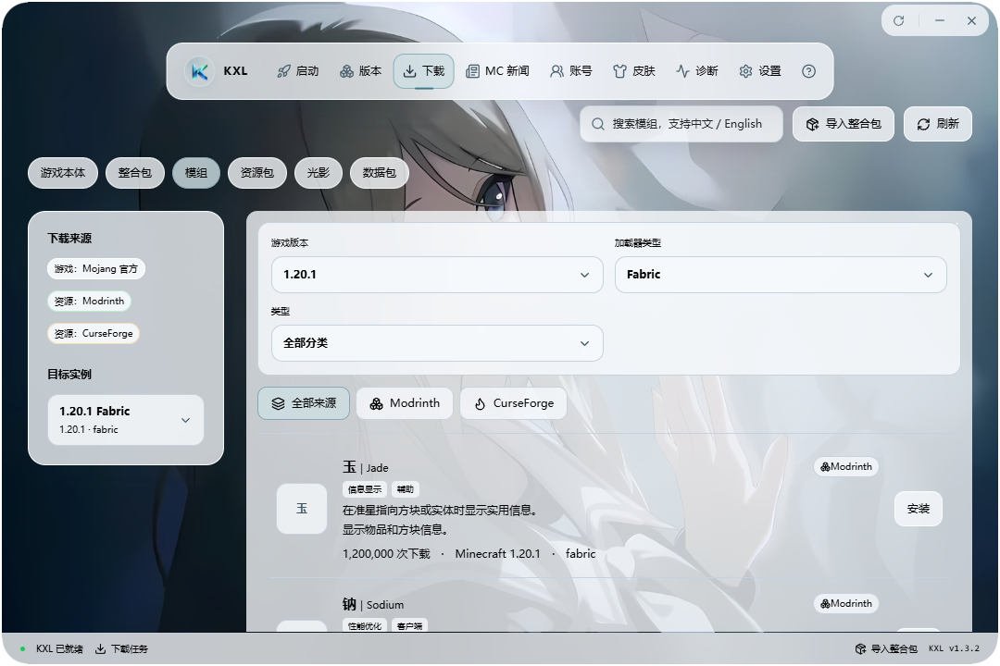
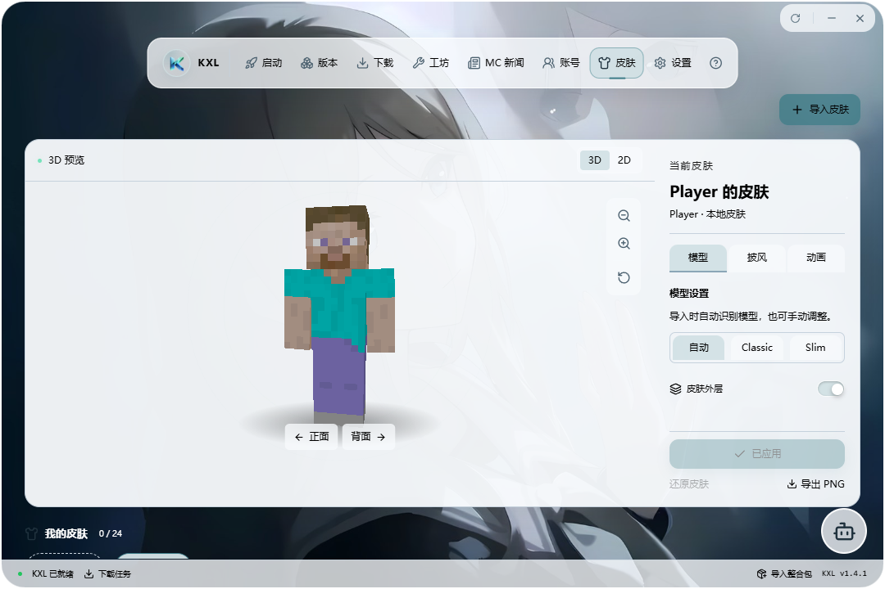

# Kynex Launcher（KXL）

Windows 上的 Minecraft 启动器。当前正式版是 **v1.3.2**，当前公开源码也已更新到 v1.3.2。

[下载完整安装器](https://github.com/mianste/Kynex-Launcher/releases/tag/v1.3.2) · [更新日志](CHANGELOG.md) · [反馈问题](https://github.com/mianste/Kynex-Launcher/issues)

## 有哪些功能

- 安装和启动 Minecraft Java 版，管理 Fabric、Quilt、Forge、NeoForge 和 OptiFine。
- 添加、切换多个游戏目录，识别目录里已有的版本。
- 给单个版本指定运行目录，分别管理模组、资源包、光影、存档和数据包。
- 搜索 Modrinth、CurseForge 资源，选择目标版本安装，同一资源可以装到多个版本。
- 导入、导出整合包，检查文件、管理模组更新。
- 管理微软、离线和外置认证账号，查看和更换皮肤、披风。
- 查看 Minecraft 新闻、调整主题透明度、检查启动日志。

## 下载安装

在 [v1.3.2 发布页](https://github.com/mianste/Kynex-Launcher/releases/tag/v1.3.2) 下载 `Kynex.Launcher.v1.3.2.Setup.exe`，运行安装器即可。支持 Windows 10 / 11 x64。

原更新签名私钥已丢失，本版启用了新签名。旧版用户需要手动覆盖安装 v1.3.2 一次，之后继续自动更新。安装时会保留原有用户资料。

完整安装版的新更新源是 [stable-v2.json](https://github.com/mianste/Kynex-Launcher/releases/download/updater-stable/stable-v2.json)。旧 `stable.json` 保留原内容。

## 界面

以下图片来自 v1.3.2 公开源码，使用示例账号、实例和资源数据，没有执行真实下载或登录。

### 启动页



### 游戏目录和版本管理



### 资源下载



### 皮肤预览



## 开源范围

公开部分包括界面、Java 版安装和启动、版本与目录管理、资源下载、整合包、账号、皮肤、新闻和日志诊断。

音乐、一键进服／进入存档，以及基岩版、地下城和传奇的本地检测与启动模块继续保留在完整安装版中，不在此仓库公开。公开代码不包含实际 API Key、Microsoft Client ID、更新私钥或账号资料。

自行编译的程序标为“公开构建”，使用独立的应用数据目录，方便与完整安装版区分。微软登录需要配置自己的 Client ID；CurseForge 官方接口需要自己的 API Key。更新源和更新公钥默认留空，需要自动更新时请配置自己的签名和更新地址。

## 开发和编译

使用 Tauri 2、React、TypeScript。需要 Node.js 22+、pnpm 11.25.0、Rust 和 Tauri 的 Windows 构建环境。

```powershell
pnpm install --frozen-lockfile
pnpm typecheck
pnpm test
pnpm build
cargo test --locked --no-default-features --manifest-path src-tauri/Cargo.toml
pnpm tauri build
```

游戏目录的用法见 [目录说明](docs/GAME-DIRECTORY-REFERENCE.md)，构建环境见 [BUILD.md](docs/BUILD.md)。

## 许可

公开代码采用 [MIT License](LICENSE)，第三方资料见 [许可说明](docs/THIRD-PARTY-NOTICES.txt)。未公开模块不属于本仓库的许可范围。

本项目与 Mojang、Microsoft、PCL 和 HMCL 无关联。请通过官方渠道购买 Minecraft。
