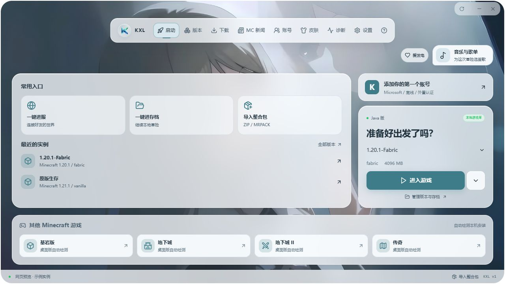
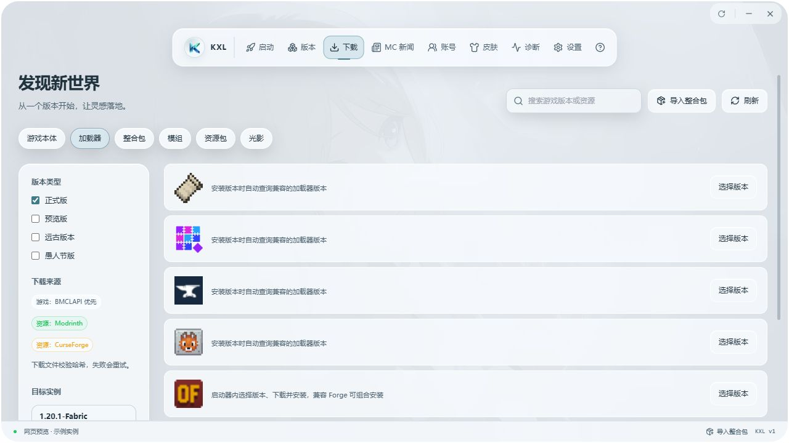
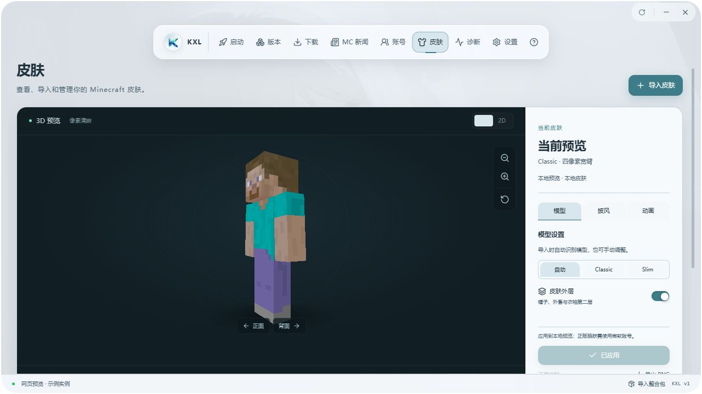

<div align="center">
  
  <h1>Kynex Launcher</h1>
  <p>从版本管理到进入游戏，把你的 Minecraft 冒险放在同一个窗口。</p>
  <p>
    <a href="https://github.com/mianste/Kynex-Launcher/releases/tag/updater-stable"></a>
    
    <a href="LICENSE"></a>
  </p>
  <p>
    <a href="https://github.com/mianste/Kynex-Launcher/releases/tag/updater-stable">下载正式版 v1.2.4</a> ·
    <a href="https://github.com/mianste/Kynex-Launcher/releases/tag/updater-beta">下载预览版 beta 1.2.4</a> ·
    <a href="https://github.com/mianste/Kynex-Launcher/issues">反馈问题</a> ·
    <a href="https://afdian.com/a/keke_657">爱发电</a>
  </p>
</div>

## 介绍

Kynex Launcher，简称 **KXL**，把游戏启动、版本管理、整合包导入、资源下载和账号皮肤管理放在同一个窗口中。你可以安装喜欢的 Minecraft Java 版与加载器，为不同玩法建立独立实例，再从首页选择账号与版本进入游戏。

界面采用中文文案，保留自定义壁纸、浅色与深色主题，以及日常管理游戏所需的常用入口。

## 界面一览

### 你的游戏，从这里出发



<table>
  <tr>
    <td width="50%"><strong>版本与加载器</strong><br>选择游戏版本，管理加载器与资源下载。</td>
    <td width="50%"><strong>皮肤工作台</strong><br>在三维视图中查看和管理你的皮肤。</td>
  </tr>
  <tr>
    <td></td>
    <td></td>
  </tr>
</table>

<sub>截图来自完整发行版界面的网页预览，使用示例实例；公开源码范围见下文。</sub>

## 主要功能

- **安装与启动**：管理 Java 版实例，安装原版及 Fabric、Quilt、Forge、NeoForge、OptiFine 等加载器；检查游戏依赖并匹配 Java 环境。
- **模组与整合包**：浏览 Modrinth、CurseForge 资源，导入整合包，管理模组、资源包、光影、数据包与存档文件。
- **账号与皮肤**：支持微软正版、离线和外置认证账号，提供皮肤导入、二维与三维预览及账号皮肤管理。
- **日常工具**：查看 Minecraft 新闻、调整实例设置、管理文件夹，并通过日志诊断排查常见启动问题。

完整发行版还提供音乐播放、一键进服／进入存档，以及基岩版、地下城系列、传奇等其他 Minecraft 游戏的本地检测与启动入口。

## 下载与使用

前往 **[Releases 下载正式版 v1.2.4](https://github.com/mianste/Kynex-Launcher/releases/tag/updater-stable)**，选择 `Kynex.Launcher.v1.2.4.Setup.exe`。安装包适用于 Windows 10 / 11（64 位）。

预览版请前往 [beta 1.2.4 发布页](https://github.com/mianste/Kynex-Launcher/releases/tag/updater-beta)，选择 `Kynex.Launcher.beta.1.2.4.Setup.exe`。已安装旧版本的用户可在启动器中检查更新，正式版与预览版分别使用各自更新通道。

安装后，在「下载」中安装游戏版本，或导入已有整合包；随后添加账号，在「启动」页选择实例进入游戏。正版登录需要有效的 Minecraft Java 版所有权及官方服务授权。

## 相关资源

- [程序下载](https://github.com/mianste/Kynex-Launcher/releases/tag/updater-stable)：获取已发布的安装包。
- [问题反馈](https://github.com/mianste/Kynex-Launcher/issues)：报告问题或提出建议。
- [支持开发](https://afdian.com/a/keke_657)：通过爱发电支持 KXL。

## 关于源代码

这里公开的是 **开发者预览版 beta 1.2.4 的公开源代码**，包括界面、Java 版安装与启动、资源下载、实例管理、账号、皮肤及诊断等模块。

以下内容不在公开仓库中：音乐模块；一键进服／进入存档；基岩版、地下城 1／2、传奇的本地检测与启动模块；项目实际的 API Key、Microsoft Client ID、密钥及账号凭据。

因此，仓库源码与完整发行版的功能范围不同。公开源码保留必要配置入口，开发者需使用自己的配置；微软 Client ID 可通过 `KXL_MICROSOFT_CLIENT_ID` 或登录弹窗的本地配置提供，CurseForge API Key 可通过 `KXL_CURSEFORGE_API_KEY` 提供。更新源及更新公钥配置默认留空。

## 开发与构建

项目使用 Tauri 2、React、TypeScript。准备 Node.js 22+、pnpm 11.25.0、Rust 稳定版及 Tauri 的 Windows 构建环境后运行：

```powershell
pnpm install --frozen-lockfile
pnpm typecheck
pnpm test
pnpm build
cargo test --locked --no-default-features --manifest-path src-tauri/Cargo.toml
pnpm tauri build
```

自行构建的版本对应 beta 1.2.4 的公开部分。安装器输出在 `src-tauri/target/release/bundle/nsis/`；更新签名私钥和发布者证书不随源码提供。

## 许可

公开源码采用 [MIT License](LICENSE)。第三方依赖与素材保留各自权利，详见 [第三方许可声明](docs/THIRD-PARTY-NOTICES.txt)。未公开模块不属于本仓库的许可范围。

本项目与 Mojang、Microsoft、PCL 无关联。请通过官方渠道购买 Minecraft。
