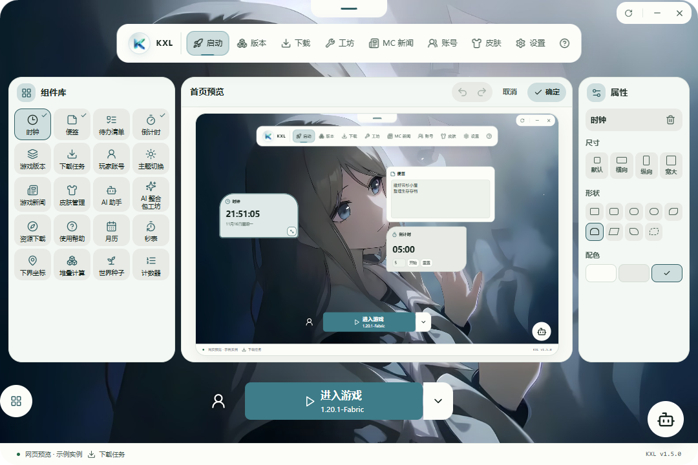
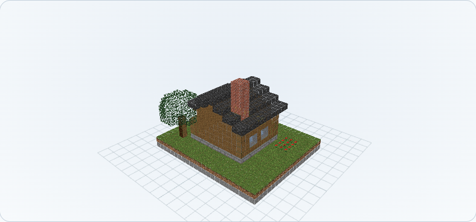

# Kynex Launcher

Kynex 是一个给 Windows 用的 Minecraft Java 版启动器。可以在这里装游戏、下模组和整合包，也可以让不同版本各用各的游戏文件夹。首页可以用自定义组件排版。

[下载 Windows 安装器](https://github.com/mianste/Kynex-Launcher/releases/download/v1.5.1/Kynex.Launcher.v1.5.1.Setup.exe) · [看这版改了什么](CHANGELOG.md) · [下载源码](https://github.com/mianste/Kynex-Launcher/releases/download/v1.5.1/Kynex.Launcher.v1.5.1.Open.Source.zip) · [反馈问题](https://github.com/mianste/Kynex-Launcher/issues)

## 怎么装

用 Windows 10 或 11 的 64 位电脑下载安装器，双击打开，按提示装好就能用。已经在用 Kynex 的玩家，可以在启动器里检查更新，也可以下载新版安装器直接覆盖安装。很早的版本请先手动覆盖安装一次。

## 能做什么

- 安装原版 Minecraft，也可以装 Fabric、Forge、NeoForge、Quilt 和 OptiFine。
- 在「下载」里找 Modrinth 和 CurseForge 上的模组、整合包、资源包、数据包和光影。点「安装」就能在选版本时翻看作者上传的预览图。
- 让不同版本各用各的文件夹，分开管理模组和存档。建好存档后，可以选中它安装数据包。
- 管理微软账号、离线账号、皮肤和披风。
- 从首页左下角打开组件库，在缩小的首页预览里拖动和拉伸组件，可调整形状、圆角与配色，点「确定」应用布局。
- 在「下载 → 投影」找建筑。可以先旋转、缩放看看，再把投影文件存到选中的游戏版本。在「版本设置 → 投影文件管理」也能打开自己已有的投影文件。

## 自定义首页

## 投影预览

## 想自己编译

[构建说明](docs/BUILD.md)写了要装哪些工具和怎么运行。需要看目录是怎么分的，可以看[游戏目录说明](docs/GAME-DIRECTORY-REFERENCE.md)。

这里提供的是公开源码。完整安装版另外带有音乐、快速进服和打开存档。自己编译的版本用自己的数据文件夹。要用微软登录、CurseForge 官方接口或自动更新，请按构建说明填写自己的设置。

公开代码使用 [MIT 许可证](LICENSE)。第三方素材和代码见[许可说明](docs/THIRD-PARTY-NOTICES.txt)。Kynex 与 Mojang、Microsoft、PCL 或 HMCL 无关联。请从官方渠道购买 Minecraft。
